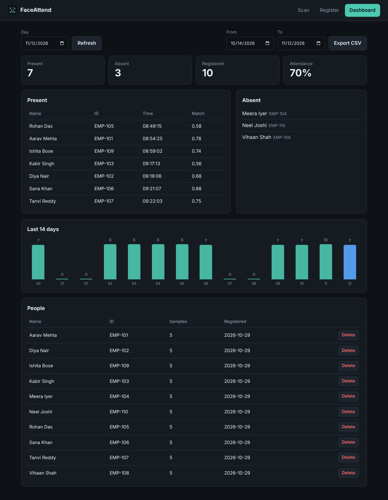
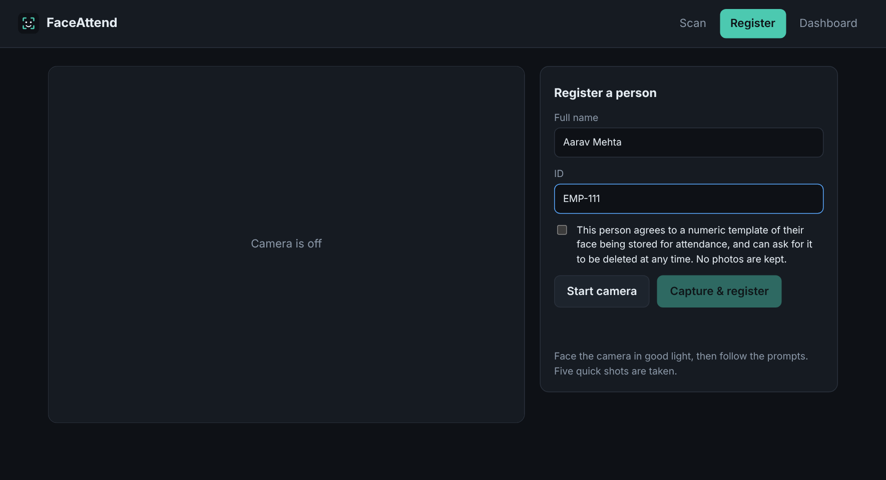

# FaceAttend

**Walk up. Get recognised. Marked present.**

FaceAttend is attendance by face recognition that runs in the browser. People register once in front of the webcam, then are marked present automatically when they walk up to the camera. A dashboard shows who is in, who is missing, and exports CSV.

[](https://github.com/ram15x/Face-Recognition-System/actions/workflows/ci.yml)



*Screenshots use made-up demo data (`python -m faceattend.demo`).*

## How it helps

Roll calls and sign-in sheets take time and are easy to fake or forget. FaceAttend replaces them with a camera at the door: nobody queues, nobody signs for a friend, and the day's attendance is ready as soon as the last person walks in. It needs only a laptop and a webcam, or any machine a browser can reach.

## What it does

- **Scan.** A live camera view puts a box and a name over every recognised face. Several people in one frame work.
- **Register.** A guided capture takes five shots, with prompts to turn your head slightly. The server checks each shot has exactly one clear, large-enough face.
- **Dashboard.** Present and absent lists for any day, a 14-day trend, CSV export, and deleting a person.
- **Unknown faces stay unknown.** A stranger is never forced onto the nearest registered name.
- **No double entries.** Attendance is recorded once per person per day.
- **Confirm before marking.** A person must be recognised twice within a few seconds, so a single bad frame can't mark the wrong person.
- **Duplicate-face check** at registration, so the same person can't be enrolled twice under different names.



## How it works

```
browser camera --JPEG frame--> POST /api/recognize
                                   |
                  YuNet finds faces |  (OpenCV, ONNX)
                                   v
                  SFace turns each face into 128 numbers
                                   |
              compare with every stored embedding (cosine similarity)
                                   |
        +--------------------------+--------------------------+
   below threshold                                     above threshold
   "Unknown"                              seen twice in a few seconds?  --> record attendance
```

## Architecture

- **Detection and recognition:** YuNet (face detection) and SFace (face embedding) from the [OpenCV Zoo](https://github.com/opencv/opencv_zoo), run through OpenCV's own DNN module. No PyTorch, TensorFlow or dlib to install.
- **Server:** FastAPI, with an optional admin token for registering, listing, deleting and exporting. Scanning stays open so a kiosk works without logging in.
- **Storage:** SQLite. Only embeddings (128 numbers per sample) are stored. No photos are saved.
- **Front end:** plain JavaScript with no build step. The camera is read in the browser and frames are uploaded, so the same code works on a laptop, a kiosk or a server.

```
faceattend/
  app.py        HTTP API, admin token, security headers
  service.py    registration and attendance rules
  faces.py      YuNet + SFace wrapper
  matching.py   similarity search with unknown rejection
  db.py         SQLite storage
  models.py     model downloader
  static/       the web UI (HTML, CSS, JavaScript)
tests/
```

## Tech stack

Python 3.11+, FastAPI, Uvicorn, OpenCV (DNN, ONNX models), NumPy, SQLite, plain HTML/CSS/JavaScript, Docker, GitHub Actions, pytest and ruff.

## Privacy

- Only embeddings are stored, never photos.
- Registration requires an explicit consent tick.
- Deleting a person removes their embeddings and their attendance history.
- The `data/` folder is git-ignored and holds all biometric data.

## Run it

You need [Python](https://www.python.org/downloads/) 3.11 or newer.

```bash
git clone https://github.com/ram15x/Face-Recognition-System.git
cd Face-Recognition-System

python -m venv .venv
# Windows:   .venv\Scripts\activate
# macOS/Linux: source .venv/bin/activate

pip install -r requirements.txt
python -m faceattend.models      # downloads the two model files (about 38 MB), once
python -m faceattend             # starts the server
```

Open <http://127.0.0.1:8000>. Browsers only allow camera access on `localhost` or over HTTPS, so use that address.

With Docker: `docker compose up --build`. The models are downloaded while the image builds, and the data lives in a Docker volume.

### Configuration

Everything is an environment variable.

| Variable | Default | What it does |
| --- | --- | --- |
| `ATTENDANCE_ADMIN_TOKEN` | *(unset)* | If set, registering, listing, deleting and exporting need this token. Set it whenever the server is reachable by anyone else. |
| `ATTENDANCE_MATCH_THRESHOLD` | `0.40` | Minimum cosine similarity to accept a match. Raise it for fewer wrong matches, lower it if people are often not recognised. |
| `ATTENDANCE_CONFIRM_HITS` | `2` | Sightings needed before attendance is recorded. |
| `ATTENDANCE_CONFIRM_WINDOW_S` | `6` | The time window for those sightings, in seconds. |
| `ATTENDANCE_DETECT_THRESHOLD` | `0.85` | Minimum detector confidence for a face to count. |
| `ATTENDANCE_MIN_FACE_PX` | `80` | Smallest face accepted at registration. |
| `ATTENDANCE_DATA_DIR` | `./data` | Where the database is kept. |
| `ATTENDANCE_MODELS_DIR` | `./models` | Where the model files are kept. |

## Build and test

```bash
pip install -r requirements-dev.txt
python -m faceattend.models
python -m pytest
ruff check . && ruff format --check .
```

The matching, rules and API are tested with a stand-in face engine, so those tests run without the models. `tests/test_real_models.py` runs the real YuNet and SFace models. CI downloads them, runs everything on Python 3.11 and 3.13, then builds the Docker image and checks that it starts.

## Credits

Face detection: **YuNet**. Face recognition: **SFace**. Both from the OpenCV Zoo (MIT and Apache-2.0 licensed). Built with [OpenCV](https://opencv.org/) and [FastAPI](https://fastapi.tiangolo.com/).

Released under the [MIT License](LICENSE).
